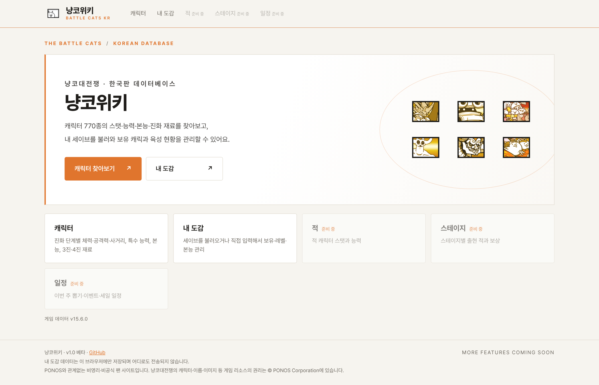
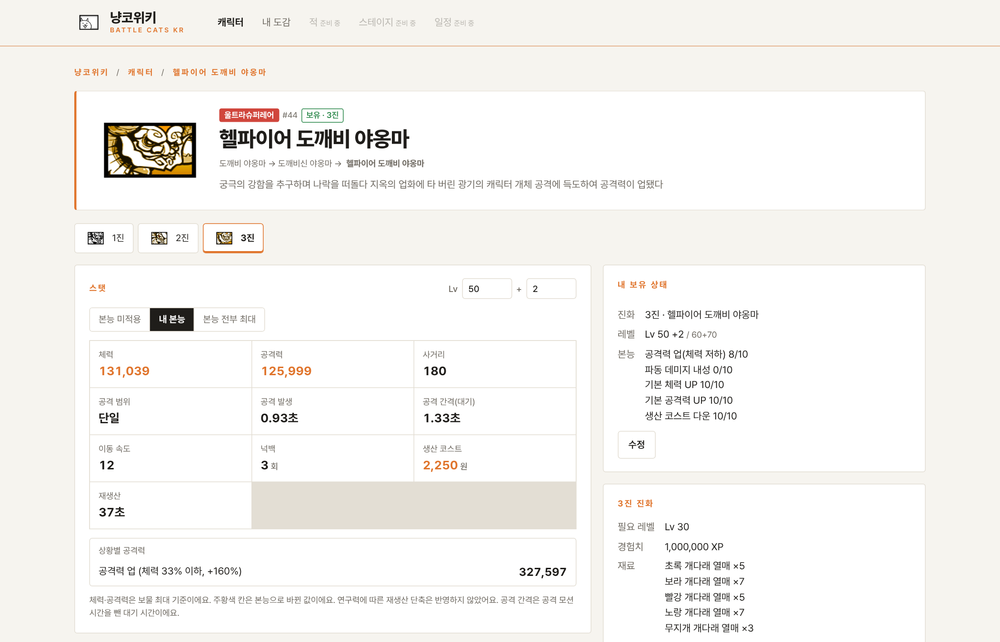
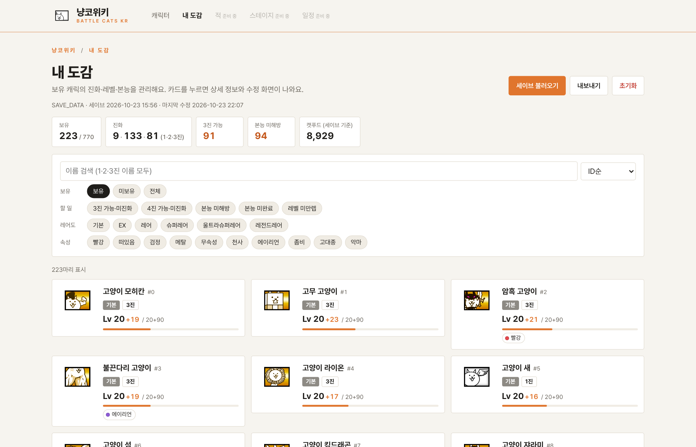
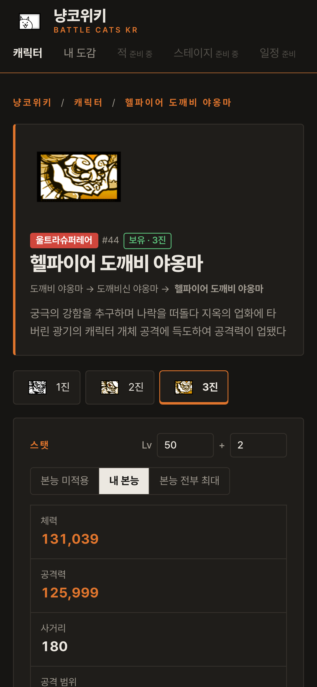

# 냥코위키

**냥코대전쟁(한국판) 캐릭터 데이터와 내 육성 현황을 한눈에**

<picture>
  <source media="(prefers-color-scheme: dark)" srcset="images/v1.0-home-dark.png">
  
</picture>

## 냥코위키가 뭔가요?

냥코는 오래된 게임이라 편의성이 아쉽습니다. 캐릭 스탯 하나 보려 해도 여기저기 찾아봐야 하고, 캐릭은 수백 마리인데 누구를 3진 했는지, 몇 레벨인지, 본능은 어디까지 찍었는지 게임 안에서 한눈에 볼 방법이 없습니다.

냥코위키는 **캐릭터 데이터 찾아보기**와 **내 육성 현황 관리**를 한 사이트에 모았습니다.

- 모든 정보는 게임 데이터에서 직접 뽑아서 만듭니다. 게임이 업데이트되면 데이터만 다시 뽑으면 반영됩니다.
- 📱 폰에서도 됩니다. 세이브 추출만 PC 전용이고, 캐릭 찾아보기와 내 도감 직접 입력은 폰에서도 그대로 쓸 수 있습니다.
- 내 도감에 입력한 데이터는 내 브라우저에만 저장되고 어디로도 전송되지 않습니다.

## 주요 기능

### 🐾 캐릭터

아군 캐릭 770종 목록과 캐릭별 상세 페이지.

<picture>
  <source media="(prefers-color-scheme: dark)" srcset="images/v1.0-cat-dark.png">
  
</picture>

- **진화 단계별 스탯**: 체력·공격력(레벨 지정 계산, 보물 최대 기준), 사거리, 공격 발생, 공격 간격, 이동 속도, 코스트, 재생산, 넉백
- **본능 적용 스탯**: [본능 미적용 / 내 본능 / 본능 전부 최대]를 골라서 비교. 체력·공격력 %, 이동 속도, 넉백, 코스트, 재생산, 공격 간격까지 반영하고, 본능으로 바뀐 칸은 주황색으로 표시 (3진부터 적용, 보유 캐릭은 내 본능이 기본)
- **상황별 공격력**: 공격력 업(체력 저하) 발동, 엄청 강하다(×1.8)·초 데미지(×4) 대상, 혼신의 일격, 크리티컬(×2) 때의 실제 공격력
- **타겟 속성·특수 능력**: 빨강·떠있음·검정 등 타겟과 파동·쉴드·초생명체 같은 능력. 본능으로 생기거나 강해진 능력엔 "본능" 표시
- **본능 설명**, **3진·4진 진화 재료**(필요 레벨·경험치·재료)
- **본능옥**: 슬롯이 있는 캐릭은 종류·대상 속성·등급(D부터 S까지)을 골라 끼워볼 수 있습니다. 데미지 업·엄청 강하다 강화·초 데미지 강화는 상황별 공격력에, 데미지 경감·맷집 강화는 효과 목록에 반영됩니다.
- **내 보유 상태**: 내 도감에 넣은 정보가 상세 페이지에도 뜨고, 거기서 바로 수정. 진화 재료 옆에 내 보유량·부족분 표시

### 📒 내 도감

<picture>
  <source media="(prefers-color-scheme: dark)" srcset="images/v1.0-dex-dark.png">
  
</picture>

- **세이브 불러오기**: PC 추출 도구로 내 세이브를 읽어서 보유 캐릭·진화·레벨+플러스·본능을 한 번에 채웁니다. 수백 마리를 일일이 입력하지 않아도 됩니다.
- **직접 수정**: 캐릭을 눌러 보유 여부, 진화 단계, 레벨+플러스, 본능 레벨을 고칩니다. 세이브 없이 처음부터 직접 입력해도 됩니다.
- **할 일 필터**: **지금 바로 진화 가능**(레벨·재료 모두 충족), 3진·4진 레벨 충족, 본능 미해방·미완료, 레벨 미만렙만 골라보기
- **레어도·속성 필터**, **검색·정렬**(1·2·3진 이름 모두 검색, ID·레어도·레벨 순)
- **자동 저장·백업**: 브라우저에 자동 저장, [내보내기]로 파일 백업 후 다른 기기에서 불러오기

### 🌱 육성 (v2.0)

- **재화·재료**: 세이브에서 경험치·NP·캣푸드·티켓, 개다래 씨앗·열매, 수석, 캐츠아이, 본능옥 보유량을 불러옵니다. 직접 고쳐도 됩니다.
- **지금 바로 진화 가능**: 보유 캐릭 중 레벨과 재료가 모두 충족된 캐릭 목록
- **육성 계획**: 진화시키고 싶은 캐릭(3진·4진)을 담으면 필요한 경험치·재료 합계와 부족분을 계산합니다.
- **보유 본능옥**: 세이브 기준 본능옥을 등급별로 보여줍니다.

### 🚧 준비 중

적 · 스테이지 · 일정

## 사용법

### 1. 캐릭 찾아보기 (폰 · PC)

[냥코위키](https://crexont.github.io/nyanko-wiki/) 접속 → 상단 [캐릭터] → 이름을 검색하거나 목록에서 캐릭 누르기. 상세 페이지에서 레벨을 바꿔가며 스탯을 보고, 본능 버튼으로 본능을 찍었을 때와 비교할 수 있습니다.

### 2. 내 도감 직접 입력 (폰 · PC)

상단 [내 도감] → [직접 입력할게요] → 가진 캐릭을 눌러 보유·진화·레벨·본능 입력 → 자동 저장

### 3. 세이브로 내 도감 채우기 (PC + 블루스택 5)

1. [Releases](../../releases/latest)에서 `NyankoWiki-v2.0-win64.zip`을 받아 압축을 풉니다. 파이썬·7-Zip 설치는 필요 없습니다.
2. 폰에서 **기종변경 코드**를 발급받아 블루스택 5의 냥코(한국판)로 계정을 옮기고 게임을 한 번 실행합니다.
3. 블루스택을 **완전히 종료**합니다 (작업 표시줄 트레이 아이콘까지).
4. `NyankoWiki.exe`를 실행하면 같은 폴더에 `냥코_세이브.json`이 생기고 [내 도감]이 열립니다.
5. [세이브 불러오기]를 누르거나 json 파일을 화면에 끌어다 놓습니다.

게임을 더 진행했다면 3, 4, 5번만 다시 하면 됩니다. 이미 입력된 내 도감이 있으면 **[전부 바꾸기]** 또는 **[재화·재료만]**을 고를 수 있습니다. 재화·재료만 바꾸면 직접 고친 캐릭 정보는 그대로 남고, 육성 계획·본능옥 선택은 어느 쪽이든 유지됩니다. 폰으로 돌아갈 땐 블루스택에서 다시 기종변경 코드를 발급받아 폰에 입력하면 됩니다 (게임의 정상 기능).

> **처음 실행할 때 "Windows의 PC 보호" 창이 뜨면** [추가 정보] → [실행]을 누르세요. 코드 서명을 하지 않은 개인 프로젝트라 뜨는 경고입니다.

 

## 🤔 왜 꼭 블루스택인가요?

세이브를 불러오려면 블루스택으로 계정을 옮겼다가 다시 폰으로 돌려놔야 해서 번거로운 점, 알고 있습니다.

게임 세이브는 폰 안에서 냥코 앱만 열어볼 수 있는 곳에 저장돼 있어서, 아이폰이든 안드로이드 폰이든 다른 프로그램이 꺼내 읽는 게 막혀 있습니다. 루팅·탈옥 말고는 꺼낼 방법이 마땅치 않습니다. 블루스택은 PC 안에서 돌아가는 안드로이드라 그 파일을 PC에서 바로 읽을 수 있어서, 지금으로선 계정이나 세이브를 건드리지 않고 읽어오는 거의 유일한 방법입니다.

더 편한 방법을 찾으면 바로 바꾸겠습니다. 블루스택이 없어도 내 도감에 직접 입력하면 모든 기능을 똑같이 쓸 수 있습니다.

## 🔒 계정은 괜찮나요?

- 추출 도구는 블루스택 가상 디스크(`C:\ProgramData\BlueStacks_nxt\Engine\<인스턴스>\Data.vhdx`)에서 `SAVE_DATA`를 **읽기만** 합니다. 세이브 수정·서버 업로드는 하지 않습니다.
- 세이브는 [BCSFE](https://github.com/fieryhenry/BCSFE-Python)로 읽어서 보유 캐릭·진화·레벨·본능만 `냥코_세이브.json`에 담습니다.
- 내 도감 데이터는 내 브라우저에만 저장되고 어디로도 전송되지 않습니다.
- 소스 코드는 전부 이 저장소에 공개되어 있습니다.

인스턴스가 여러 개면 세이브가 가장 최근인 인스턴스를 고릅니다. 직접 지정하려면 명령 프롬프트에서 `NyankoWiki.exe --instance Pie64`처럼 실행하세요.

## ❓ 문제 해결

| 증상 | 해결 |
|---|---|
| "Windows의 PC 보호" 창이 뜸 | [추가 정보] → [실행] |
| 백신이 exe를 막음 | PyInstaller로 만든 exe에서 생기는 오탐입니다. 백신에서 NyankoWiki 폴더를 예외로 추가한 뒤 다시 실행 |
| "블루스택이 실행 중입니다" | 블루스택을 트레이 아이콘까지 완전히 종료한 뒤 다시 실행 |
| "블루스택 5 인스턴스를 찾지 못했습니다" | 블루스택 5가 설치돼 있는지 확인 (블루스택 4 이하는 미지원) |
| "세이브가 있는 인스턴스가 없습니다" | 블루스택에서 냥코(한국판)로 계정을 옮겨 한 번 실행한 뒤 종료하고 재시도 |
| 내 도감에 입력한 내용이 사라짐 | 브라우저 방문 기록·사이트 데이터를 지우면 함께 지워집니다. [내보내기]로 백업해 두세요 |
| 업데이트했다는데 화면이 예전 그대로 | PC는 Ctrl + F5, 폰은 시크릿 탭으로 열어보세요 |
| 스탯이 게임과 다름 · 새 캐릭이 안 보임 | 캐릭 이름 + 레벨 + 어떤 수치인지 [이슈](../../issues)로 알려 주세요 |

## 다음 업데이트 예정

1. 적 · 스테이지 · 일정 메뉴 (재료 드랍 스테이지 일정 포함)
2. 캐릭터 상세에 얻는 방법(뽑기 · 스테이지)
3. 육성 계획에 레벨업 경험치까지 포함
4. 블루스택 안드로이드 11 이상 인스턴스 지원 확인

## 라이선스

Copyright (C) 2026 crexont

[GPL-3.0](LICENSE) 라이선스입니다. 세이브를 읽는 데 쓰는 BCSFE가 GPL-3.0이라서 같은 라이선스를 따릅니다.

- 누구나 자유롭게 쓰고, 고치고, 다시 배포할 수 있습니다.
- 고쳐서 배포할 때는 소스 코드도 같은 GPL-3.0으로 공개하고, 원래 저작권 표시를 남겨야 합니다.
- 냥코대전쟁의 캐릭터·이름·이미지 같은 게임 리소스는 이 라이선스의 대상이 아닙니다.

## 크레딧

- [BCSFE-Python](https://github.com/fieryhenry/BCSFE-Python): 세이브 파싱, 게임 데이터 다운로드
- [BCData](https://git.battlecatsmodding.org/fieryhenry/BCData): 캐릭터 이름·스탯·레어도·본능 데이터
- [Battle Cats Ultimate](https://github.com/battlecatsultimate/BCU_java_util_common): 본능 효과 계산 방식 참고
- [7-Zip](https://www.7-zip.org): 가상 디스크 읽기. 배포판에 `7z.exe`, `7z.dll`을 동봉하며 라이선스는 `7z/License.txt`를 따릅니다.

냥코위키는 수익을 목적으로 하지 않는 비영리·비공식 팬 사이트입니다. 냥코대전쟁의 캐릭터·이름·이미지 등 게임 리소스의 권리는 © PONOS Corporation에 있습니다.
